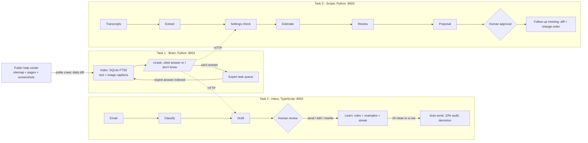

# DESIGN

> DRAFT written with Claude. Rewrite the "problem" section in your own words and make sure you can explain every
> choice below at the live review. Replace every "TBD" with a measured number from `EVALS.md`.

## 1. The problem
Code got 10x cheaper. A website change that cost $2,000 now costs about $200. A tech company that wants to keep its
salaries must do 10-20x more projects, and the work that does not shrink is everything around the code: knowing the
product, answering email fast and correctly, and turning loose client talk into a scope that is quoted, agreed, and
protected from quiet growth. One person doing that by hand cannot scale.

So the product is one loop: **Brain** (what is true) -> **Inbox** (tell the customer) -> **Scope** (price new work, and
check the Brain first for a setting that makes the work unnecessary). Every human correction flows back in.

## 2. How the three tasks connect

Tasks 2 and 3 never import Task 1 code. They use `POST /v1/ask` and degrade safely if it is down.

## 3. Features I chose, and why
**Task 1 - Brain**
- *One global rate limit, robots.txt, Retry-After, resumable SQLite queue.* A first crawl of hundreds of pages must not hurt a real server, and a crash at page 300 must not mean starting again. Defaults: 1 request/second, batches of 25 with a pause.
- *Screenshots are captioned by a vision model and stored as their own searchable chunk linked to the article.* The answer is often in the picture. Captions are cached by image hash, so an image used on 40 pages is paid for once.
- *Daily sitemap diff.* Added, updated (by `lastmod`; pages with no `lastmod` are refetched and compared by content hash), removed. A removed article is hard-deleted from the index, so it cannot appear in an answer.
- *Answer only with a valid citation.* The model must cite source numbers; a citation to a source that was not retrieved, or `confident: false`, becomes "I don't know" plus a task.
- *Expert loop.* The expert's answer is indexed as a first-class source and shown as "expert answer", so the next customer gets it.

**Task 2 - Inbox**
- *"Same kind" = category + canonical topic* (e.g. `how_to:change-plan-price`). A kind earns auto-send after **20 sends in a row with similarity >= 0.98** between draft and final (case, punctuation and whitespace ignored). One real edit resets it to 0.
- *Learning from edits:* every edit stores the human's version as an example for that kind, and a model distils one reusable rule ("Always link the help article"). Rules are versioned (`draft@1+r2`) and each has an Undo button.
- *Losing the freedom:* 10% of would-be auto-sends are held as an audit sample; 2 of the last 10 audits changed -> demoted and the streak resets. A customer who reacts badly to an auto-sent reply demotes immediately.
- *"Is it improving?"* per kind, unchanged-rate in the first half vs the latest half of its history (shown on the "What it has learned" screen).

**Task 3 - Scope**
- *Map-reduce over transcript windows* split on speaker turns with overlap, so long meetings do not lose items in the middle.
- *Numbers come from code, words come from the model.* Totals, overhead (PM 10%, QA 15%) and prices are computed; the proposal's table cannot contain a number the model invented.
- *Settings check:* every feature is first asked of the Brain ("is there an existing setting?"). A hit becomes a 0.5-1.5h configuration task with the source attached.
- *Follow-up meetings update the scope:* new statements are matched to agreed items (same / modified / removed / new). Unchanged items **keep their agreed hours**. Anything new is labelled "outside agreed scope - quote as change order" with its own price.
- *Approval gate in code, not in the UI:* `client_view()` raises unless a human approved; the API returns 403.

## 4. Needs nobody wrote down (found, then built)
1. A broken sitemap must not wipe the Brain: removals are blocked if the sitemap shrinks below 50% of known pages.
2. Expert answers must survive the daily sync (sync only touches web pages).
3. Duplicate unanswered questions make one task, not fifty.
4. A "we're checking" holding reply approved unchanged must not count toward auto-send (found while testing; fixed).
5. Drafts are checked for links not in the knowledge base and for money amounts not in the knowledge base or the customer's email.
6. Refunds, complaints, quotes and new projects (money, feelings, commitments) can never auto-send.
7. Emails are treated as data: a "ignore previous instructions" email is classed as spam and gets no reply.
8. Unreadable transcript windows and failed estimates are flagged to the reviewer instead of silently dropped.

## 5. What I dropped, and why
- *Real mailbox connection (Gmail/IMAP).* Sending is a logged outbox. The learning loop is the hard part; a connector is plumbing.
- *Embeddings / vector DB.* BM25 first, because it is explainable and free. Cost: vocabulary mismatch (see 7). Next step if evals show it matters.
- *Knowledge graph, user accounts, multi-tenant UI.* Not needed to prove the loop. "Any business can plug in" is met by config: sitemap URL, voice, rate card.
- *Automatic send of proposals.* Nothing leaves without a person, by design.
- *Learning inside Task 3.* Task 3 has versioned prompts but no feedback learner yet.

## 6. Model choices (TBD - fill from EVALS.md)
Plan: a cheap Claude model for high-volume, low-risk steps (image captions, email classification, transcript extraction)
and a stronger one where quality shows to the customer (cited answers, drafts, estimates, reconcile, proposal summary).
Each choice needs 20-30 cases comparing both models; until `EVALS.md` has those numbers this is a hypothesis.
Model names are environment variables, so switching is a config change.

## 7. What breaks (known, today)
- Retrieval is keyword-based: a question that shares a common word with an article ("payments") can pass the coverage check when the topic is absent. Seen in the Task 1 eval: "blockchain payments" matched the Stripe article.
- Image captions are not verified; a wrong caption becomes a wrong fact. Needs a spot-check eval on real screenshots.
- The Scope matcher is fuzzy text similarity. Ambiguous items default to "new" (quote extra), which is safe for the company but can annoy a client.
- Estimates come from a model with no history of past projects. Treat as a first draft for a developer.
- Task 2 is typed strictly, but `tsc` was not available where this was built: run `make typecheck`.
- JSON-file stores are single-process. Fine for a demo, not for production.
- The 3 transcripts in `task3_scope/fixtures` are synthetic. The brief needs 3 recorded role-plays.
- Mock mode proves wiring, not quality. Its numbers must never appear in the results tables.

## 8. What I would build next
Hybrid retrieval (BM25 + embeddings) behind the same interface; caption spot-check eval; a feedback learner for Task 3
(developer edits to estimates become a calibration factor per task type); real mailbox connector; per-tenant config.
